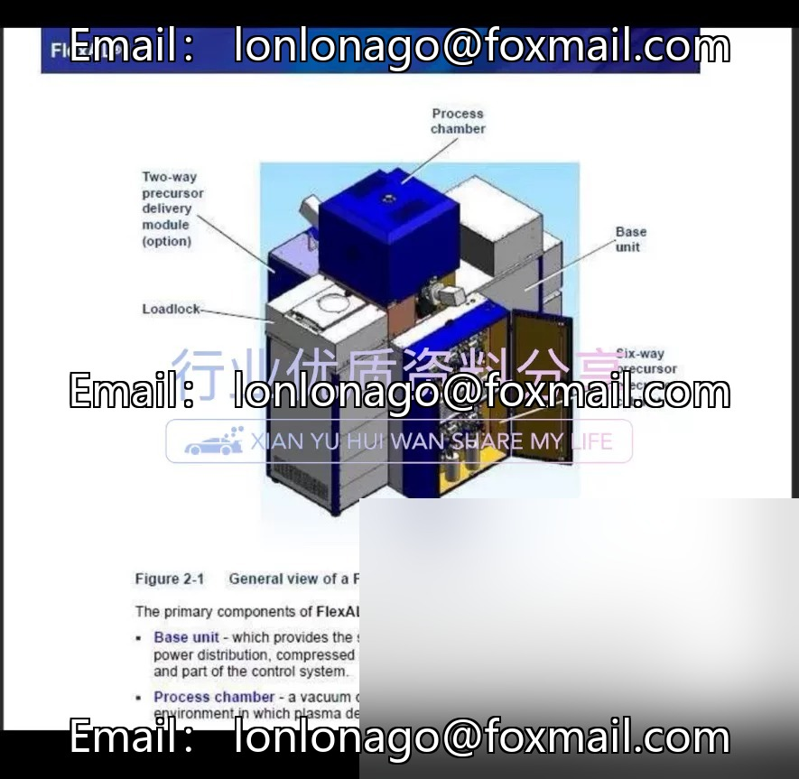
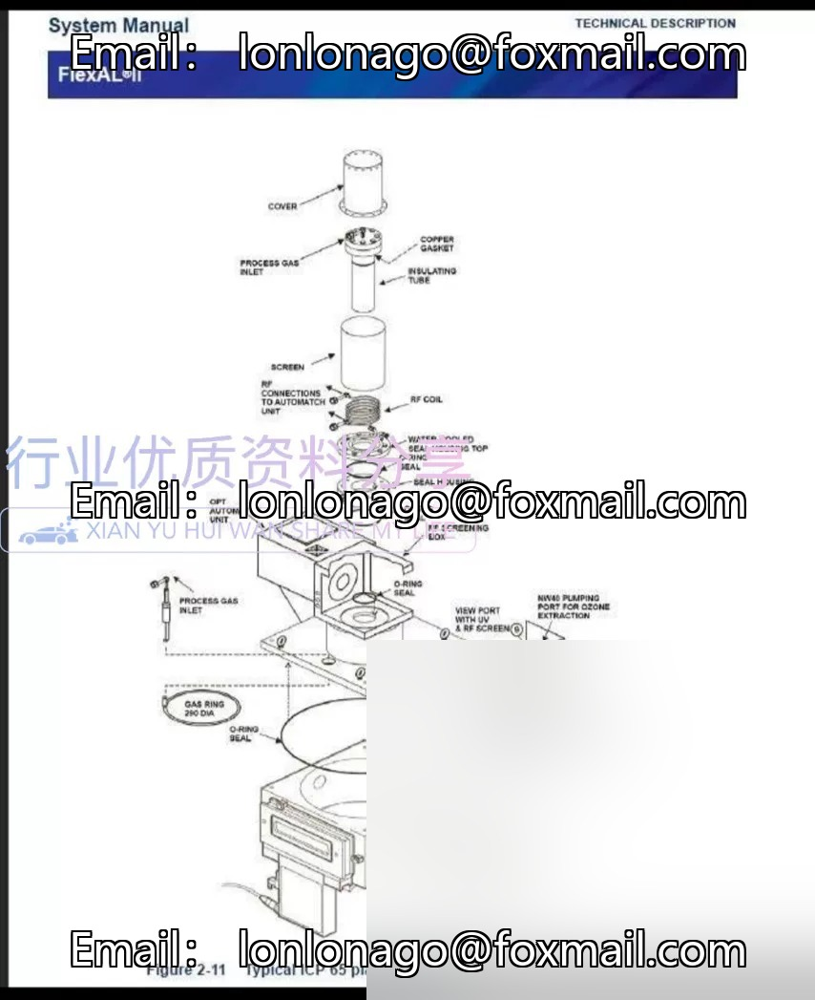
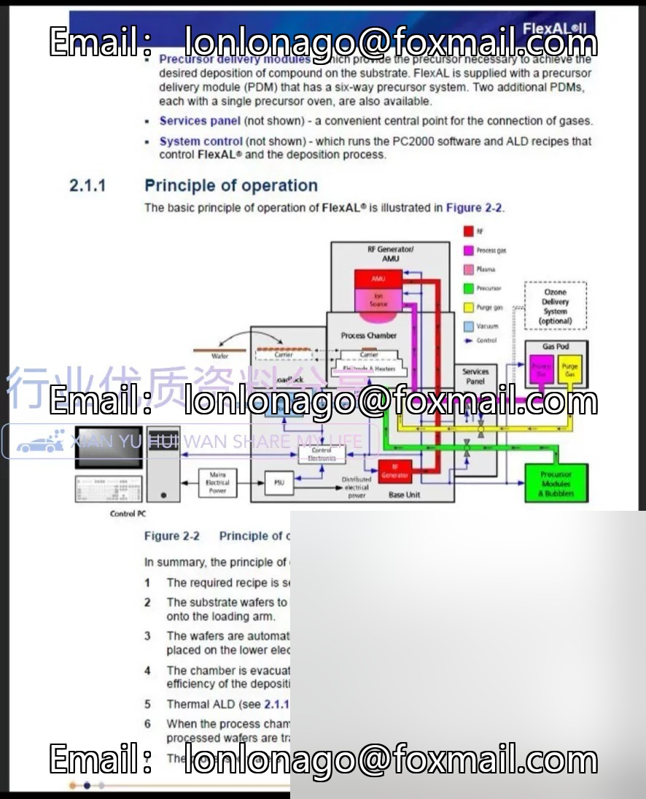
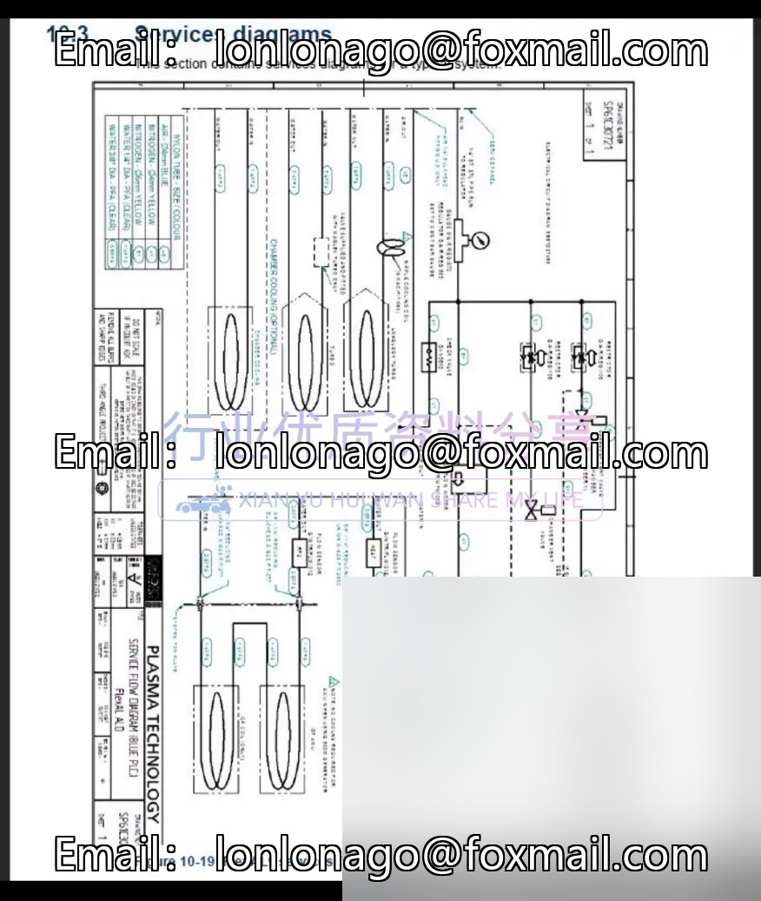
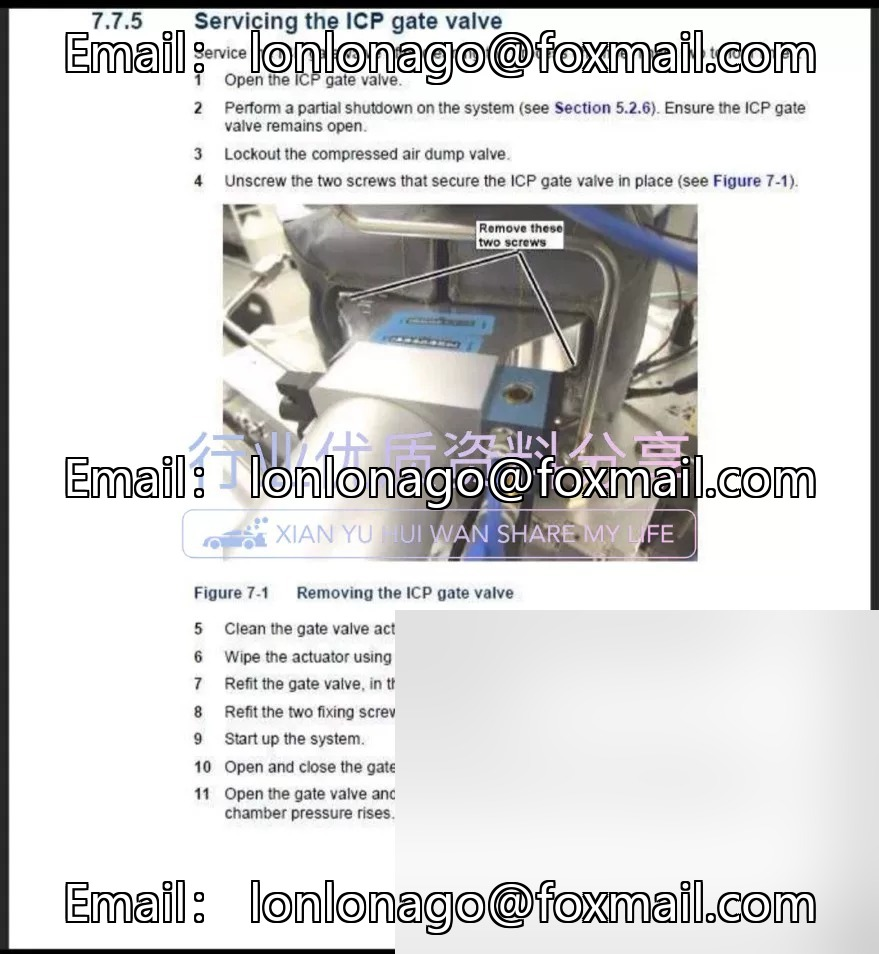

# British Oxford Oxford Plasma Flex ALD atomic layer sedimentation

## Body

English materials for the Oxford Oxford Plasma Flex ALD atomic layer deposition equipment technology (including structure descriptions, circuit diagrams, tube diagrams, etc.), with high reference value (over 400 pages).

Capture and send the electronic original directly! The following images include screenshots of the file portion. Please confirm before placing the order! Due to the replicable nature of electronic documentation Therefore, are allowed after purchase! Thanks for understanding!

For personal learning and reference use only.

The technical materials include structural descriptions, circuit diagrams and pipeline diagrams with over 400 pages of reference value; the images contain partial file screenshots requiring confirmation before ordering, the electronic archive is copyable, and the purchase is non-returnable; it is for personal study and reference only.

<!-- AI_ENRICHED -->

## Images

## Payment

Here is a pay link on Stripe ( https://buy.stripe.com/3cs8yP7sY87d0vu9AB ). Please contact me lonlonago@foxmail.com after funding $89, and I will send you a complete data files , thank you!

